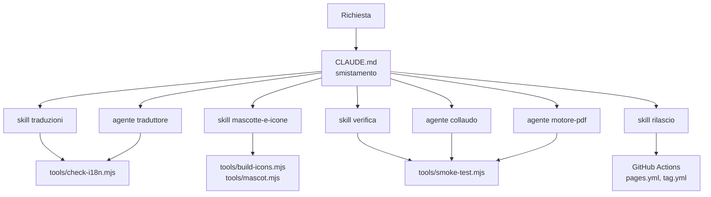

# Lavorare al progetto con gli agenti

Il repository è predisposto perché un agente di programmazione (Claude Code, o un altro che legga `AGENTS.md`) possa mantenerlo senza che gli si debba rispiegare ogni volta come è fatto. Non è un servizio che gira da qualche parte: sono file di istruzioni e strumenti che l'agente trova quando apre il progetto.

## I pezzi

| Pezzo | File | A cosa serve |
|---|---|---|
| **Smistamento** | `CLAUDE.md` | Viene letto all'inizio di ogni sessione. Contiene la mappa dei file, le regole fisse e la tabella che dice quale skill o agente usare per ogni tipo di richiesta. |
| **Skill** | `.claude/skills/<nome>/SKILL.md` | Procedure passo passo per i lavori ricorrenti. L'agente le carica solo quando servono. |
| **Agenti** | `.claude/agents/<nome>.md` | Ruoli specializzati che lavorano in un contesto separato e restituiscono un resoconto. |
| **Strumenti** | `tools/*.mjs` | Programmi veri che controllano il lavoro: gli agenti li eseguono invece di «credere» che funzioni. |

### Skill

| Skill | Quando |
|---|---|
| `traduzioni` | Qualsiasi testo dell'interfaccia; aggiunta di una lingua |
| `mascotte-e-icone` | Disegno della pressa, icone, favicon, animazione di caricamento |
| `verifica` | Dopo ogni modifica e prima di pubblicare |
| `rilascio` | Nuova versione, tag, pubblicazione |

### Agenti

| Agente | Cosa fa | Può modificare i file? |
|---|---|---|
| `traduttore` | Rilegge una lingua come un madrelingua. Se ne possono lanciare tanti in parallelo, uno per lingua. | Solo il blocco della sua lingua |
| `motore-pdf` | Si occupa della compressione: PDF che non calano, immagini rovinate, formati nuovi | Sì |
| `collaudo` | Esegue tutti i controlli e cerca ciò che i controlli non vedono | No, solo rapporto |

### Strumenti

| Comando | Cosa controlla | Serve installare qualcosa? |
|---|---|---|
| `node tools/check-i18n.mjs` | Stesse chiavi e stessi segnaposto in tutte le lingue | No |
| `node tools/smoke-test.mjs` | Lingue, layout a larghezza telefono, compressione reale di un PDF di prova | `cd tools && npm install` |
| `node tools/build-icons.mjs` | Rigenera icone e disegni dalla mascotte | Come sopra (o `--no-png`) |

Il primo gira anche su GitHub prima di ogni pubblicazione: una traduzione incompleta blocca il deploy.

## Esempi di richieste

Si scrive in linguaggio normale; lo smistamento fa il resto.

- «Aggiungi il giapponese» → skill `traduzioni`, poi `verifica`.
- «Fai rileggere tutte le traduzioni» → un agente `traduttore` per lingua, in parallelo.
- «Fai sorridere di più la mascotte» → skill `mascotte-e-icone`.
- «Questo PDF non si alleggerisce, perché?» → agente `motore-pdf`.
- «Siamo pronti per pubblicare?» → agente `collaudo`.
- «Rilascia la 1.3» → skill `rilascio`.

Per chiamare un pezzo in modo esplicito: `/traduzioni`, `/rilascio`, oppure «usa l'agente collaudo».

## Estendere

- **Nuova skill:** crea `.claude/skills/<nome>/SKILL.md` con in testa `name` e `description`. La descrizione è ciò che fa scegliere la skill: scrivi *quando* usarla.
- **Nuovo agente:** crea `.claude/agents/<nome>.md` con `name`, `description` e, se vuoi limitarlo, `tools`.
- **In entrambi i casi** aggiungi una riga alla tabella di smistamento in `CLAUDE.md` e a questa pagina.
- **Nuovo strumento:** mettilo in `tools/`, senza dipendenze se possibile, e citalo nella skill che lo usa.

## Cosa gli agenti non possono fare

- Verificare a orecchio i suoni o provare l'installazione su un telefono vero.
- Garantire traduzioni da madrelingua: l'agente `traduttore` migliora, non certifica.
- Cambiare le impostazioni del repository su GitHub (per esempio la sorgente di Pages).
