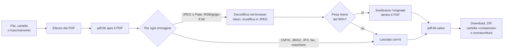

# Architettura

Schiaccia PDF è una pagina statica. Non c'è server applicativo, non c'è build: il browser scarica i file e fa tutto da solo, sul dispositivo dell'utente.

## Come viaggia un PDF

Il testo, i link e la struttura delle pagine non vengono toccati: cambia solo il contenuto dei flussi immagine. Per questo il testo resta selezionabile e per questo un PDF senza immagini non si alleggerisce.

## I tre livelli di forza

| Livello | Qualità JPEG | Lato lungo massimo |
|---|---|---|
| Carezza (`soft`) | 0,82 | 2400 px |
| Stretta (`mid`) | 0,68 | 1700 px |
| Martellata (`hard`) | 0,50 | 1200 px |

Sono in `PRESETS`, in cima allo script di `index.html`.

## Sezioni di `index.html`

Lo script è diviso da commenti `/* ---------- nome ---------- */`:

| Sezione | Cosa fa |
|---|---|
| lingue | Scelta della lingua dal browser, funzione `t()`, applicazione dei testi |
| carico | Scelta file, lettura cartelle (fino a 6 livelli), trascinamento, schermata di caricamento annullabile |
| vista | Disegna l'elenco dei file e i totali |
| motore | Compressione: `squeezePdf` e `squeezeImage` |
| salvataggio | Download, ZIP, scrittura in cartella, sovrascrittura con conferma |
| avvio | Menu delle lingue |
| suoni | Jingle e effetti, sintetizzati con Web Audio (nessun file audio) |
| installazione | Pulsante «Installa l'app» e istruzioni per iPhone |

## Lettura delle cartelle

Tre strade, a seconda del browser:

1. **`showDirectoryPicker`** (Chrome ed Edge da computer): dà accesso in lettura e scrittura. È l'unica che permette «Salva in compressi» e «Sovrascrivi gli originali».
2. **`<input webkitdirectory>`**: ripiego in sola lettura.
3. **Trascinamento** di file e cartelle: sola lettura.

In tutte e tre si scende al massimo di 6 livelli, si saltano le cartelle nascoste e quelle di uscita (in qualsiasi lingua), e un file illeggibile viene saltato senza interrompere la lettura.

## Lingue

`i18n.js` definisce `window.I18N`: un oggetto per lingua, stesse chiavi ovunque. Il markup porta gli attributi `data-i18n*`; `applyLang()` li riempie. La lingua scelta a mano viene ricordata in `localStorage`. Arabo e urdu impostano `dir="rtl"` e il layout si specchia da solo perché usa proprietà logiche e flex.

## App installabile e offline

- `manifest.webmanifest` e le icone rendono l'app installabile.
- `sw.js` tiene in cache i file dell'app e li serve subito, aggiornandoli in sottofondo: per questo una versione nuova si vede alla seconda apertura.
- Il nome della cache viene cambiato dal flusso di pubblicazione a ogni deploy, così le versioni vecchie vengono scartate.

## Pubblicazione

`.github/workflows/pages.yml` controlla le traduzioni, copia in `_site/` solo i file dell'app e li pubblica su GitHub Pages a ogni push su `main`. Lo stesso flusso scrive accanto al titolo il numero preso da `VERSION` (in locale compare «dev»). `.github/workflows/tag.yml` crea il tag `v<numero>` quando cambia `VERSION`.

## Limiti noti

- Immagini CMYK, JBIG2, JPEG 2000 e CCITT non vengono ricompresse.
- PDF protetti da password vengono saltati.
- PDF molto grandi dipendono dalla memoria del dispositivo: tutto avviene in RAM.
- Su iPhone non si possono scegliere cartelle; su Firefox e Safari non si può scrivere nelle cartelle.
