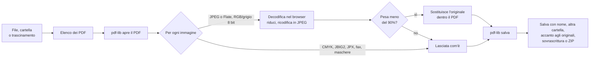

# Architettura

Schiaccia PDF è una pagina statica. Non c'è server applicativo, non c'è build: il browser scarica i file e fa tutto da solo, sul dispositivo dell'utente.

## Come viaggia un PDF

Il testo, i link e la struttura delle pagine non vengono toccati: cambia solo il contenuto dei flussi immagine. Per questo il testo resta selezionabile e per questo un PDF senza immagini non si alleggerisce.

## I tre livelli di forza

| Livello | Qualità JPEG | Lato lungo massimo |
|---|---|---|
| Carezza (`soft`) | 0,82 | 2400 px |
| Stretta (`mid`) | 0,68 | 1700 px |
| Martellata (`hard`) | 0,50 | 1200 px |

Sono in `PRESETS`, in cima allo script di `index.html`.

## Sezioni di `index.html`

Lo script è diviso da commenti `/* ---------- nome ---------- */`:

| Sezione | Cosa fa |
|---|---|
| lingue | Scelta della lingua dal browser, funzione `t()`, applicazione dei testi |
| carico | Scelta file, lettura cartelle (fino a 6 livelli), trascinamento, schermata di caricamento annullabile |
| vista | Disegna l'elenco dei file e i totali |
| motore | Compressione: `squeezePdf` e `squeezeImage` |
| salvataggio | Pulsanti sotto l'elenco, finestre di dialogo (`ask`), scrittura nelle cartelle (`writeJobs`) con schermata annullabile, ZIP di ripiego |
| avvio | Menu delle lingue |
| suoni | Jingle e effetti, sintetizzati con Web Audio (nessun file audio) |
| musica | Sottofondo generato nota per nota: un tema solo in più umori (calma durante l'uso, mistero mentre legge una cartella, concitata mentre comprime, gioia mentre scrive i file, fanfara a salvataggio riuscito) |
| occhi | La mascotte strizza gli occhi a intervalli casuali, scegliendo a caso tra due espressioni |
| condivisione | Pulsante di condivisione: foglio di sistema dove esiste, altrimenti copia il link |
| installazione | Pulsante «Installa l'app» e istruzioni per iPhone |

## Lettura delle cartelle

Tre strade, a seconda del browser:

1. **`showDirectoryPicker`** (Chrome ed Edge da computer): dà accesso in lettura e scrittura. Ogni file porta con sé il proprio riferimento (`handle`) e quello della cartella che lo contiene (`dir`): servono per sovrascrivere e per salvare accanto agli originali.
2. **`<input webkitdirectory>`**: ripiego in sola lettura.
3. **Trascinamento** di file e cartelle: sola lettura.

In tutte e tre si scende al massimo di 6 livelli, si saltano le cartelle nascoste, e un file illeggibile viene saltato senza interrompere la lettura.

## Salvataggio

Le regole di comportamento sono in `REQUISITI.md`; qui come sono realizzate.

| Azione | Cosa serve | Come |
|---|---|---|
| Salva con nome (un file) | niente | `showSaveFilePicker`, altrimenti download |
| Altra cartella | `showDirectoryPicker` | si sceglie la destinazione e si ricrea il percorso relativo di ogni file; senza quella funzione, uno ZIP con gli stessi percorsi |
| Accanto agli originali | `dir` su ogni file (cartella scelta con `showDirectoryPicker`) | nuovo nome con prefisso o suffisso nella stessa cartella dell'originale |
| Sovrascrivi | `handle` su ogni file (cartella scelta, oppure file scelti con `showOpenFilePicker`) | `createWritable` sull'originale |

`render()` accende o spegne i pulsanti in base a questi requisiti e mostra la riga di spiegazione quando qualcosa è spento. Prima di scrivere in una cartella si contano i file che esistono già e si chiede conferma. I file trascinati nella pagina non portano permessi di scrittura.

## Suoni e musica

Niente file audio: tutto è sintetizzato con Web Audio. Il pulsante con l'altoparlante accende o spegne insieme effetti e musica; la scelta è ricordata in `localStorage`. Il sottofondo ha un volume volutamente basso (`VOL` nella sezione «musica»).

La musica è un giro di otto battute (`PROG` e `TEMA` nella sezione «musica»). Un temporizzatore mette in coda le note con un terzo di secondo di anticipo, così l'umore può cambiare al volo: `music.setMood("mystery")` mentre la schermata di caricamento legge una cartella (la stessa melodia su un giro con un accordo di re maggiore al posto del la minore, suonata staccata e rada: curiosa, non cupa), `music.setMood("joy")` mentre la stessa schermata scrive i file (tema veloce e saltellante, a due voci, cassa su ogni tempo e battimani), `music.setMood("drive")` quando parte la compressione (il tempo sale gradualmente e il filtro si apre), `music.setMood("calm")` alla fine, `music.festa()` ai salvataggi in blocco, alla sovrascrittura completata e al salvataggio dell'unico file. I browser non fanno partire l'audio prima di un'interazione, quindi la musica comincia al primo tocco; quando la pagina va in secondo piano l'audio si sospende.

## Lingue

`i18n.js` definisce `window.I18N`: un oggetto per lingua, stesse chiavi ovunque. Il markup porta gli attributi `data-i18n*`; `applyLang()` li riempie. La lingua scelta a mano viene ricordata in `localStorage`. Arabo e urdu impostano `dir="rtl"` e il layout si specchia da solo perché usa proprietà logiche e flex.

## App installabile e offline

- `manifest.webmanifest` e le icone rendono l'app installabile.
- `sw.js` tiene in cache i file dell'app per l'uso senza rete. Pagina e testi si chiedono prima alla rete (la cache subentra se manca o non risponde entro quattro secondi), così una versione nuova si vede alla prima apertura; librerie, icone e font si prendono prima dalla cache.
- Quando una versione nuova prende il controllo, la pagina aperta si ricarica da sola, ma solo se non ci sono file in elenco né finestre aperte.
- Il nome della cache viene cambiato dal flusso di pubblicazione a ogni deploy, così le versioni vecchie vengono scartate.

## Pubblicazione

`.github/workflows/pages.yml` controlla le traduzioni, copia in `_site/` solo i file dell'app e li pubblica su GitHub Pages a ogni push su `main`. Lo stesso flusso scrive accanto al titolo il numero preso da `VERSION` (in locale compare «dev»). `.github/workflows/tag.yml` crea il tag `v<numero>` quando cambia `VERSION`.

## Limiti noti

- Immagini CMYK, JBIG2, JPEG 2000 e CCITT non vengono ricompresse.
- PDF protetti da password vengono saltati.
- PDF molto grandi dipendono dalla memoria del dispositivo: tutto avviene in RAM.
- Su iPhone non si possono scegliere cartelle; su Firefox e Safari non si può scrivere nelle cartelle.
